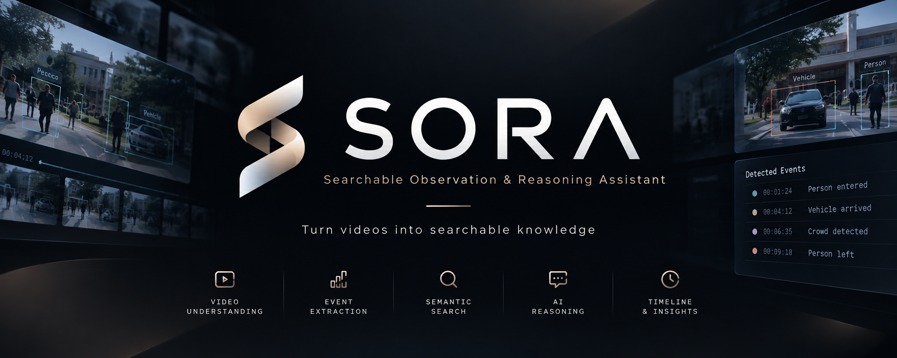

# SORA — Searchable Observation & Reasoning Assistant

<p align="center">
  
</p>

<p align="center">
  <strong>An open-source, local-first AI video intelligence platform that converts surveillance and long-form video into structured, searchable, and explainable incident events.</strong>
</p>

<p align="center">
  
  
  
  
  
  
</p>

---

## 🔍 The Problem

Traditional video surveillance and computer vision tools suffer from two major flaws:
1. **Raw Frame Clutter:** Detections stop at raw bounding boxes. Logging thousands of `10:42:15 -> Person detected` records is meaningless to an investigator.
2. **Scrubbing Fatigue:** Finding a single incident (e.g., someone picking up a laptop or entering a restricted room at night) requires humans to waste hours manually scrubbing through hours of footage.
3. **Expensive & Slow Cloud AI:** Feeding hours of raw video into multimodal LLMs costs hundreds of dollars in API bills, is painfully slow, and frequently hallucinates timestamps.

---

## 💡 The SORA Solution

**SORA** introduces a **Two-Stage Filtering Funnel**:

```
[ Raw Video (Hours of Footage) ]
               │
               ▼  Stage 1: Fast & Free (Local YOLOv8 + ByteTrack)
Filters out 95%+ of static footage and extracts high-level semantic actions
               │
               ▼  Stage 2: Structured Event Timeline & Reasoning
Enables instant search and Q&A backed by exact verifiable video timestamps
```

- **Events Over Frames:** Groups continuous observations into real-world actions:
  > *`[02:14 - 02:26]` Person (ID: 1) approached the laptop on the desk.*
- **Evidence Over Hallucination:** Every question asked in natural language returns an answer backed by **clickable video timestamp pills** that automatically jump the video player to the exact second.
- **100% Free & Local-First:** Runs on your machine with zero mandatory cloud subscriptions, credit cards, or external API costs.

---

## ✨ Features

- 📹 **Video Upload & Playback:** Native HTML5 player with frame-accurate timestamp seeking.
- ⚡ **Automated Event Extraction:** Frame sampling with YOLOv8 and ByteTrack to track entities (people, bags, laptops, phones) across time.
- 🕒 **Interactive Event Timeline:** Chronological event feed (arrivals, departures, proximity interactions) that automatically highlights and seeks video playback on click.
- 💬 **Ask SORA (Q&A):** Ask natural-language questions (*"When did someone approach the bag?"* or *"Who entered after hours?"*) and receive answers with jump-to-evidence links.
- 🤖 **Hybrid Reasoning:** Works out-of-the-box with smart local keyword/semantic matching, with optional support for Google Gemini API (free tier) for advanced reasoning.

---

## 🏗️ Architecture

```text
┌────────────────────────────────────────────────────────┐
│                   React Dashboard                      │
│     Video Player  │  Event Timeline  │  Ask SORA       │
└───────────────────────────┬────────────────────────────┘
                            │ (REST API / JSON)
┌───────────────────────────▼────────────────────────────┐
│                 FastAPI Backend Server                 │
│  /api/upload   │  /api/process   │  /api/events        │
└─────────────┬───────────────────────────┬──────────────┘
              │                           │
┌─────────────▼─────────────┐   ┌─────────▼──────────────┐
│  Computer Vision Engine   │   │     Reasoning Engine   │
│  - OpenCV (Sampling)      │   │  - Structured Event Log│
│  - YOLOv8 (Detection)     │   │  - Local Semantic Match│
│  - ByteTrack (Tracking)   │   │  - Gemini API (Free)   │
└───────────────────────────┘   └────────────────────────┘
```

---

## 🚀 Quickstart Guide

### Prerequisites
- **Node.js** (v18+ or v22+) & **npm**
- **Python** (v3.11 or v3.12 recommended)

---

### Step 1: Clone the Repository
```bash
git clone https://github.com/your-username/sora.git
cd sora
```

---

### Step 2: Set Up the AI Backend (FastAPI + YOLO)

1. Create and activate a Python virtual environment:
   ```bash
   # Windows (CMD)
   python -m venv venv
   venv\Scripts\activate.bat

   # Linux / macOS
   python3 -m venv venv
   source venv/bin/activate
   ```

2. Install backend dependencies:
   ```bash
   pip install fastapi uvicorn python-multipart opencv-python ultralytics google-generativeai pydantic
   ```

3. Start the FastAPI backend server:
   ```bash
   cd backend
   uvicorn main:app --reload --port 8000
   ```
   *The backend will be available at: `http://127.0.0.1:8000`*

---

### Step 3: Set Up the Frontend (React)

Open a **new terminal tab**:

1. Navigate to the project root and install React dependencies:
   ```bash
   npm install --legacy-peer-deps
   ```

2. Start the development server:
   ```bash
   npm start
   ```
   *Your browser will open automatically at: `http://localhost:3000`*

---

## 🔌 API Reference

| Method | Endpoint | Description |
| :--- | :--- | :--- |
| `POST` | `/api/upload` | Upload video file (`.mp4`, `.mov`, `.webm`) |
| `POST` | `/api/process/{video_id}` | Run YOLOv8 + ByteTrack event extraction |
| `GET` | `/api/events/{video_id}` | Fetch extracted structured event timeline |
| `GET` | `/api/video/{video_id}` | Stream video file with byte-range seeking |
| `POST` | `/api/ask` | Query events using natural language Q&A |

---

## 🗺️ Roadmap

- [x] Initial React + FastAPI scaffolding
- [x] YOLOv8 + ByteTrack object & person tracking
- [x] Chronological event timeline extraction
- [x] Clickable timestamp-seeking video player
- [x] Evidence-backed Q&A with Gemini API / local fallback
- [ ] Virtual tripwires & restricted zone drawing (geofencing)
- [ ] Visual bounding box overlay toggle on video player
- [ ] One-click PDF/CSV incident report export
- [ ] Multi-camera library & persistent history

---

## 📄 License

This project is licensed under the [MIT License](LICENSE).
